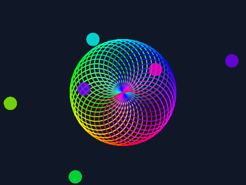

# Claude's LLVM Scratch

An ahead-of-time compiler from **Scratch 3 projects (`.sb3`) to native executables, via LLVM.**

It reproduces the official `scratch-vm`'s behaviour exactly — not just the arithmetic, but the
scheduler: which thread runs in which tick, when a frame ends, how `broadcast and wait` yields,
how a re-broadcast restarts a running script. Every result below was checked by running the same
project in real `scratch-vm` and comparing the two event traces line by line, frame numbers
included.

This was built overnight, autonomously, by Claude (Anthropic's AI model) as a capability test.
It is not affiliated with the Scratch Foundation or MIT. "Scratch" is a trademark of the Scratch
Foundation.



*Rendered by a natively compiled Scratch project (`examples/spirograph.py`). Its event trace is
identical to `scratch-vm`'s.*

## Results

**Correctness** — compared against the official `scratch-vm` 5.0.300:

| check | result |
|---|---|
| hand-written semantic tests (`tests/cases`) | **51 / 51** identical traces |
| random programs from the differential fuzzer (`tests/fuzz.py`) | **~530** generated, **0** divergences (a few skipped: they outgrow V8's string limit or take >2 min in `scratch-vm`) |
| `scratch-vm`'s own execute fixtures (`tests/conformance.py`) | **59 / 61** identical traces; passes the same 58 self-checks `scratch-vm` passes |

**Speed** — time from green flag to finish, frames stepped back-to-back, same seeded RNG, all three
producing the same answer (`bench/run.py`, median of repeated runs):

| benchmark | scratch-vm | TurboWarp | **native** | vs scratch-vm | vs TurboWarp |
|---|---:|---:|---:|---:|---:|
| recursive fib(25): 242,785 custom-block calls | 396 ms | 4.93 ms | **0.60 ms** | 656× | 8.2× |
| sieve of Eratosthenes to 100,000 on a Scratch list | 440 ms | 16 ms | **3.30 ms** | 133× | 4.8× |
| Mandelbrot 160x120, 64 iterations, float math in variables | 1.84 s | 13 ms | **4.09 ms** | 451× | 3.2× |
| bubble sort of 1,000 list items (~500k compare/swap) | 1.42 s | 16 ms | **11 ms** | 134× | 1.5× |
| build a 10,000-char string with join, then reverse it with letter-of | 36 ms | 2.96 ms | **2.69 ms** | 13× | 1.1× |
| 100,000 iterations of a normal (screen-refreshing) loop: scheduler overhead | 53 ms | 22 ms | **4.15 ms** | 13× | 5.2× |
| 100 clones each moving and bouncing for 200 frames | 49 ms | 42 ms | **4.21 ms** | 12× | 10.0× |
| **geometric mean** | | | | **72×** | **3.8×** |

`scratch-vm` is the official interpreter; TurboWarp compiles Scratch to JavaScript for V8 to JIT, and is the fastest widely used Scratch runtime. Compiling a project takes 2.0–2.3 s (mostly LLVM link-time optimisation); binaries are about 50 KB (costume images are embedded zlib-compressed). Measured on a 4-core cloud VM; absolute times vary by machine, ratios are more stable.

## How it works

```
 project.sb3 ─► load (scc/load.py) ─► analyze (scc/analyze.py) ─► codegen (scc/codegen.py) ─► LLVM IR
                                                                                              │
     runtime/*.c ─► clang -flto ─► runtime bitcode ──────────── LTO link (clang -O3 -flto) ◄──┘
                                                                        │
                                                                        ▼
                                                              native executable
```

* **Scripts are resumable state machines.** Each script and custom block compiles to
  `i32 fn(Thread*, Frame*)`. The entry block switches on the frame's saved state; the body yields
  exactly where `scratch-vm`'s sequencer would (loop back-edges outside warp mode, `wait`,
  `glide`, `broadcast and wait`, recursive custom-block calls, promise-like blocks), by storing
  the next state and returning. A small trampoline plays the role of `Sequencer.stepThread`.
* **Warp mode becomes plain native code.** A custom block marked "run without screen refresh"
  that can never yield (checked transitively) also gets a *direct* variant: an ordinary LLVM
  function with typed register parameters (`double` for numbers) and loop counters in registers.
  This is where compute-heavy projects spend their time.
* **Exact types, then specialization.** Values are `num`, `str`, `bool` or `any`. Types are
  exact because Scratch can tell the string `"1"` from the number `1` (a list of `"1","2"`
  reports `12`, a list of `1,2` reports `1 2`). A *string-identity analysis* proves where that
  difference can never be observed and turns integer literals like `set i to 0` into real
  numbers there, so loop counters and accumulators become `double`s.
* **JavaScript semantics, bit for bit.** Number formatting (`String(0.1+0.2)`), `Number()`
  parsing, `Cast.compare`, `Math.round`'s negative zero, and `Math.sin/cos/tan/asin/acos/atan/
  exp/log/pow` — the last via V8 12.4's own fdlibm port (vendored in `runtime/fdlibm`), because
  glibc differs from V8 in the last bit for `exp`/`log`, and Scratch prints full precision.
* **The runtime mirrors `scratch-vm`.** Tick budgets, redraw requests ending a frame, thread
  restart-in-place, `stop all` letting the rest of the tick's threads run once, clones joining
  the execution order behind their parent, sprite fencing, bounce, speech-bubble redraw rules,
  the 300-clone limit, `isRecursiveCall`'s 5-entry window, and many smaller quirks — each with a
  test.

## Using it

Requirements: Python 3.10+, clang/LLVM 18, zlib. Optional: `resvg-py` (`pip install resvg-py`)
to rasterize SVG costumes for rendering; Node.js 22 for the test oracle and benchmarks.

```sh
python3 -m scc project.sb3 -o project        # compile
./project                                    # run headless; prints a JSON-lines trace
./project --render frames --render-every 10  # also write PNG frames
./project --realtime                         # run at 30 fps on the wall clock
```

Runtime flags: `--frames N` (frame limit), `--ticks N` (tick budget per frame in deterministic
mode, default 64), `--seed N`, `--answers a,b,c` (answers for `ask and wait`), `--turbo`,
`--realtime`, `--bench`, `--no-trace`, `--render DIR`, `--render-every N`.

By default the program runs on a **deterministic virtual clock** (exactly 1/30 s per frame, a
fixed tick budget per frame) so runs are reproducible and comparable with the oracle.

## Testing

```sh
bench/setup.sh                    # fetch scratch-vm (and TurboWarp for benchmarks) into ref/
python3 tests/run.py              # hand-written differential tests
python3 tests/fuzz.py --count 200 # random-program differential fuzzing
python3 tests/conformance.py      # scratch-vm's own fixture projects
python3 bench/run.py              # benchmarks vs scratch-vm and TurboWarp
```

The oracle (`ref/run.js`) runs the real `scratch-vm` from source with a stub renderer (without a
renderer `scratch-vm` never requests redraws, never fences sprites and ignores `set size`), a
virtual clock, a tick-budgeted sequencer, and a seeded `Math.random` that the native runtime
reproduces. `tools/sb3.py` is a small Python DSL for writing Scratch projects in code, used by the
tests and benchmarks.

## Limitations

Known and deliberate; most follow from running headless.

* **No live input or audio.** No keyboard, mouse or microphone: `key pressed` is false, and
  `mouse x` reports `undefined`, exactly as `scratch-vm` does before any mouse event. Sound
  blocks are silent, but keep their timing (`set volume` still yields a frame; music "for beats"
  blocks still wait).
* **The warp timer is not implemented.** `scratch-vm` lets a "run without screen refresh" loop
  yield after 500 ms of real time. Here, as in TurboWarp's default, warp code runs to completion,
  so a warp loop that *waits for another script or for real time* never ends.
* **Sprite bounds use the rotated costume rectangle,** not scratch-render's convex hull of the
  opaque pixels. This affects fencing, bouncing and sprite-touching for irregular costumes
  (identical for rectangular ones). `touching color` is always false.
* **Rendering** covers backdrops, the pen layer, sprites, rotation styles, and ghost,
  brightness and color effects. It does not draw speech bubbles or the fisheye, whirl,
  pixelate and mosaic effects. JPEG costumes are not rasterized.
* **Not supported:** Scratch 2 (`.sb2`) files; extensions other than pen, music (timing only),
  and sound (timing only); the legacy pen shade/hue blocks (no-ops); TurboWarp's custom
  reporters.
* **Strings are UTF-8 internally.** `length` and `letter of` count UTF-16 code units like
  JavaScript for all of the Basic Multilingual Plane; characters outside it (e.g. emoji) differ.
  `toLowerCase` covers Latin, Greek, Cyrillic and Armenian, but not every Unicode rule (e.g.
  final sigma).
* The 2 non-identical conformance fixtures: one uses TurboWarp's non-standard custom-reporter
  extension; the other is a warp loop waiting on the timer (see the warp-timer point above).

## Layout

| path | what |
|---|---|
| `scc/` | the compiler: `load.py` (sb3 → AST), `analyze.py` (types, identity, atomicity), `codegen.py` (LLVM IR), `costumes.py` (geometry, rasterization), `rtbuild.py` (runtime build + ABI extraction) |
| `runtime/` | the C runtime: `value.c` (casts, JS number formatting/parsing), `list.c`, `sched.c` (threads, hats, clones, sequencer), `blocks.c` (looks, motion, sensing, pen, music), `render.c`, `main.c`, `fdlibm/` (vendored from V8) |
| `ref/` | the `scratch-vm` oracle (`run.js`) and benchmark runner (`bench.js`) |
| `tests/` | differential tests, fuzzer, conformance runner |
| `bench/` | benchmark projects and runner; `results.json` holds the latest numbers |
| `tools/` | `sb3.py` project DSL, `sb3dump.py` pretty-printer |

## Credits and licences

* `runtime/fdlibm/ieee754.cc` is V8's port of fdlibm (BSD-style V8 licence, `LICENSE.v8`, and
  Sun's fdlibm notice, `LICENSE.fdlibm`), compiled with small shims.
* `scratch-vm` (AGPL-3.0) and TurboWarp's `scratch-vm` fork (MPL-2.0) are used only as external
  reference implementations for testing and benchmarking. They are downloaded by
  `bench/setup.sh` and not redistributed here. The conformance fixtures are read from that
  download.
* This repository does not yet have a licence of its own; that is the owner's call.
